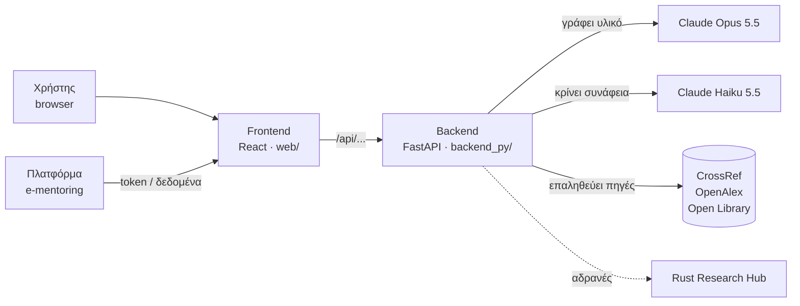
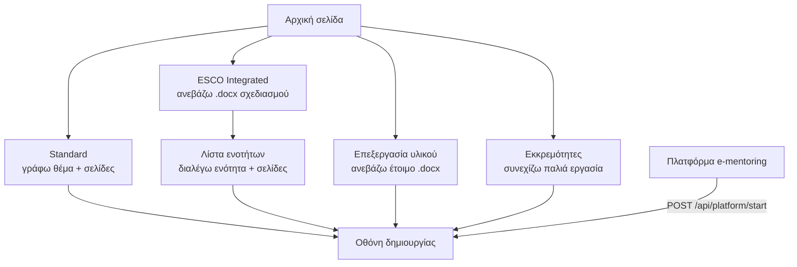
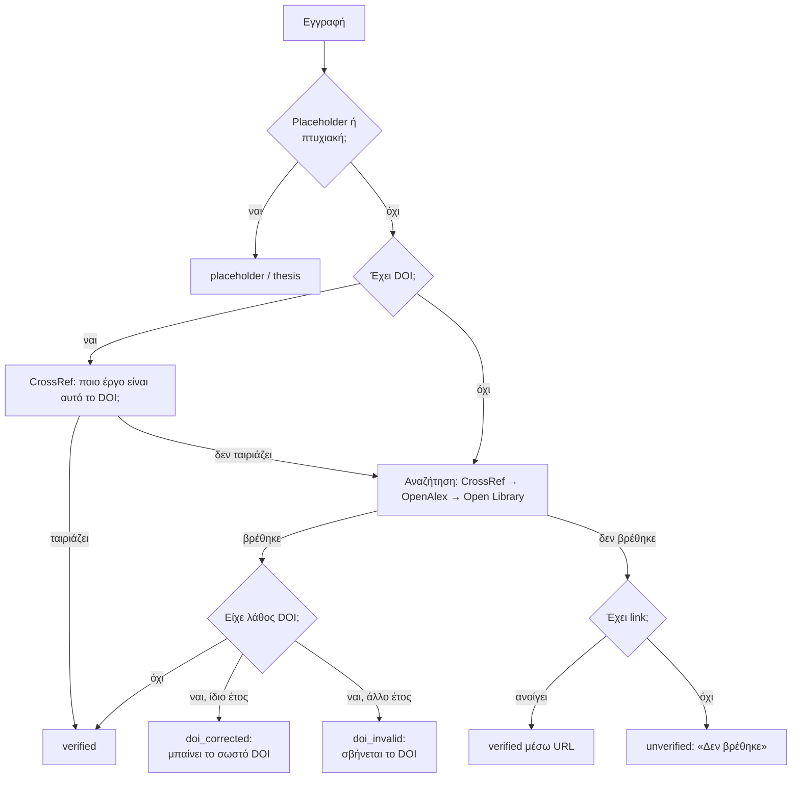

# Workflow της εφαρμογής: Δημιουργία Εκπαιδευτικού Υλικού (Οκτώβριος 2026)

> **Για ποιον είναι:** για όποιον αναλαμβάνει την εφαρμογή και θέλει να καταλάβει **πώς λειτουργεί από άκρη σε άκρη**: τι συμβαίνει από τη στιγμή που ο χρήστης πατά «Έναρξη Δημιουργίας» μέχρι να κατεβάσει το Word, και **γιατί** είναι στημένη έτσι.
>
> Δεν εξηγεί τον κώδικα γραμμή-γραμμή. Όπου βοηθά, δίνει το αρχείο ή τη συνάρτηση, ώστε να ξέρεις πού να κοιτάξεις.
>
> **Κατάσταση:** commit `1269b24` στο `main`, σε production από 1/10/2026.

---

## Περιεχόμενα

1. [Η εφαρμογή σε μία παράγραφο](#1-η-εφαρμογή-σε-μία-παράγραφο)
2. [Τα κομμάτια του συστήματος](#2-τα-κομμάτια-του-συστήματος)
3. [Οι τρεις τρόποι να ξεκινήσεις](#3-οι-τρεις-τρόποι-να-ξεκινήσεις)
4. [Ο κύκλος ζωής ενός τμήματος (η καρδιά της εφαρμογής)](#4-ο-κύκλος-ζωής-ενός-τμήματος)
5. [Οι «Αλλαγές» (revision)](#5-οι-αλλαγές-revision)
6. [Ολοκλήρωση: Περίληψη, Word, πλατφόρμα, ESCO](#6-ολοκλήρωση)
7. [Βασικές έννοιες σε βάθος](#7-βασικές-έννοιες-σε-βάθος)
8. [Γνωστοί περιορισμοί](#8-γνωστοί-περιορισμοί)
9. [Γιατί είναι έτσι: ιστορικό αποφάσεων](#9-γιατί-είναι-έτσι-ιστορικό-αποφάσεων)
10. [Production και deploy](#10-production-και-deploy)
11. [«Πού κοιτάζω όταν…»](#11-πού-κοιτάζω-όταν)
12. [Γλωσσάρι](#12-γλωσσάρι)

---

## 1. Η εφαρμογή σε μία παράγραφο

Ο χρήστης (εκπαιδευτικός σχεδιαστής) ορίζει ένα **θέμα** και **πόσες σελίδες** θέλει. Η εφαρμογή ζητά από το **Claude Opus 5.5** να γράψει ακαδημαϊκό εκπαιδευτικό υλικό στα ελληνικά, **σε τμήματα** (batches), π.χ. 55 σελίδες σε τμήματα των 20. Μετά από κάθε τμήμα, η εφαρμογή **ελέγχει αυτόματα** τη δομή και τη βιβλιογραφία, και ο χρήστης **εγκρίνει, ζητά αλλαγές ή απορρίπτει**. Στο τέλος δημιουργείται μια **Περίληψη** και όλα συγκεντρώνονται σε ένα **Word**.

Η βασική φιλοσοφία είναι **«ο άνθρωπος στο κέντρο»**: το μοντέλο γράφει, οι αυτόματοι έλεγχοι επισημαίνουν, και ο άνθρωπος αποφασίζει.

---

## 2. Τα κομμάτια του συστήματος



| Κομμάτι | Τι κάνει | Αναλογία |
|---|---|---|
| **Frontend** (`web/`) | Οθόνες, κουμπιά, κράτημα της κατάστασης της εργασίας, εξαγωγή Word (γίνεται **στον browser**) | Το γραφείο του συντάκτη |
| **Backend** (`backend_py/`) | Συνθέτει τα prompts, μιλά με τα μοντέλα, κάνει ελέγχους, ελέγχει την πρόσβαση, ρυθμίζει την κίνηση | Ο αρχισυντάκτης |
| **Claude Opus 5.5** | Γράφει το υλικό, την Περίληψη, κάνει τις «Αλλαγές» | Ο συγγραφέας |
| **Claude Haiku 5.5** | Μικρό, φθηνό μοντέλο: κρίνει αν μια πηγή ταιριάζει με το κείμενο | Ο επιμελητής |
| **CrossRef / OpenAlex / Open Library** | Δημόσιες ακαδημαϊκές βάσεις: επιβεβαιώνουν ότι μια πηγή υπάρχει | Η βιβλιοθήκη |
| **Rust Research Hub** | Παλιά μηχανή αναζήτησης πηγών. **Τρέχει, αλλά δεν χρησιμοποιείται** (βλ. §9) | Αποθήκη |
| **OpenAI (GPT)** | **Απενεργοποιημένο**. Ο κώδικας υπάρχει, ανάβει με `OPENAI_ENABLED=true` | Αναπληρωματικός |

---

## 3. Οι τρεις τρόποι να ξεκινήσεις

Η αρχική σελίδα έχει τρεις καρτέλες. Και οι τρεις καταλήγουν στην **ίδια οθόνη δημιουργίας** (`ContentGenerator`). Διαφέρει μόνο το πώς ορίζεται η «ενότητα».



| Είσοδος | Τι δίνει ο χρήστης | Τι γίνεται |
|---|---|---|
| **Standard** | Θέμα, ώρες, συνολικές σελίδες, σελίδες ανά τμήμα | Δημιουργείται μία «συνθετική» ενότητα χωρίς δεξιότητες ESCO |
| **ESCO Integrated** | Word με εκπαιδευτικό σχεδιασμό | Το `docxParser.ts` βγάζει ενότητες και δεξιότητες ESCO. Ο χρήστης διαλέγει ενότητα. Οι δεξιότητες μπαίνουν στο prompt με την εντολή «κάλυψέ τες όλες» |
| **Επεξεργασία υλικού** | Έτοιμο Word | Μετατρέπεται σε markdown και μπαίνει ως **τμήμα 1 που περιμένει έγκριση**. Από εκεί ο χρήστης κάνει «Αλλαγές» ή «Επέκταση» (νέες σελίδες στο τέλος) |
| **Από την πλατφόρμα** | Η πλατφόρμα στέλνει token + πρόταση (JSON) | Το `platform_start.py` επικυρώνει το token και ανοίγει την εφαρμογή με τις ενότητες ήδη φορτωμένες. Το `clientContext` επιστρέφει στην πλατφόρμα με την εξαγωγή |

---

## 4. Ο κύκλος ζωής ενός τμήματος

Αυτό είναι το **σημαντικότερο κομμάτι** του οδηγού. Κάθε φορά που ο χρήστης πατά «Έναρξη Δημιουργίας» ή «Δημιουργία Επόμενου Τμήματος», συμβαίνουν τα εξής:

```mermaid
sequenceDiagram
    autonumber
    participant FE as Frontend
    participant BE as Backend
    participant O as Opus 5.5
    participant DB as CrossRef/OpenAlex/OL
    participant H as Haiku 5.5

    FE->>BE: POST /api/generate-stream (ενότητα, σελίδες, δομή, οδηγίες, προηγούμενο κείμενο)
    BE->>BE: Rate limiter: σειρά προτεραιότητας (μπορεί «Θέση Ν στην ουρά»)
    BE->>BE: Σύνθεση prompt (system + δομή + προϋπολογισμός σελίδων + manifest)
    BE->>O: streaming
    O-->>FE: κείμενο ζωντανά (SSE "content")
    BE->>O: (αν χρειαστεί) αυτόματη συνέχεια
    BE->>BE: Έλεγχος δομής → SSE "structure_warnings"
    BE-->>FE: SSE "done"
    FE->>BE: (αν λείπει Βιβλιογραφία) POST /api/generate-bibliography
    FE->>BE: POST /api/verify-bibliography
    BE->>DB: υπάρχει κάθε πηγή; σωστό DOI;
    BE->>H: στηρίζει κάθε πηγή την πρότασή της; (ή το θέμα)
    BE-->>FE: αποτελέσματα + κείμενο με διορθωμένα DOI
    FE->>FE: Κάρτα τμήματος: «Βιβλιογραφία X/Y», προειδοποιήσεις, κουμπιά
```

### Βήμα 1: Τι στέλνει το frontend

Το `claudeService.generateWithStreaming` στέλνει:
- **την ενότητα:** τίτλο, ώρες, περιεχόμενο, δεξιότητες ESCO, και τις δραστηριότητες του DOCX (μόνο αν είναι ενεργές),
- **τον στόχο σελίδων του τμήματος.** Το τελευταίο τμήμα ζητά μόνο όσες σελίδες απομένουν,
- **τη «Δομή υλικού»** (`structure_config`),
- **τις οδηγίες** του χρήστη (ισχύουν για όλα τα τμήματα),
- **το εγκεκριμένο κείμενο των προηγούμενων τμημάτων**, για να συνεχίσει χωρίς επαναλήψεις,
- **το συνολικό μέγεθος της ενότητας** (`total_pages`), που χρειάζεται για το μέγεθος της Περίληψης.

### Βήμα 2: Ουρά (rate limiter)

Πριν μιλήσει με το Claude, το backend περνά από τον **rate limiter** (`rate_limiter.py`), ώστε να μην ξεπεράσουμε τα όρια του λογαριασμού Anthropic.
- Οι παραγωγές είναι **HEAVY**. Η Περίληψη, η βιβλιογραφία-fallback, η ανάλυση ESCO και ο έλεγχος συνάφειας είναι **LIGHT**.
- Με το τρέχον **Tier 2**: **1 HEAVY ταυτόχρονα σε όλο τον server**, 3 LIGHT, και 1 HEAVY ανά χρήστη. Αν κάποιος άλλος γράφει ήδη, ο χρήστης βλέπει «Θέση Ν στην ουρά αναμονής».
- Παρακολουθεί και τα output tokens ανά λεπτό, με κυλιόμενο παράθυρο 60 δευτερολέπτων.

### Βήμα 3: Σύνθεση του prompt

Το prompt φτιάχνεται από κομμάτια, σαν τουβλάκια (`llm_service.generate_content_stream`):

| Κομμάτι | Τι λέει στο μοντέλο | Πού |
|---|---|---|
| **System prompt** | Ρόλος (καθηγητής), ελληνικά, ακαδημαϊκό ύφος, APA 7th, κανόνες κατά της επινόησης πηγών | `prompts/system_prompt.py` → `EXPERIMENTAL_SYSTEM_PROMPT` |
| **Δομή** | Μόνο τα ενεργά στοιχεία. Τα ανενεργά **αφαιρούνται** από το prompt | `prompts/structure.py` |
| **Ενότητα** | Θέμα, δεξιότητες ESCO, επάγγελμα-στόχος | `_format_module` |
| **Οδηγίες χρήστη** | «ΑΚΟΛΟΥΘΗΣΕ ΤΕΣ» | |
| **Συνέχεια** (τμήμα 2+) | Επικεφαλίδες που ήδη γράφτηκαν και τα τελευταία 3.000 χαρακτήρες, με «ΜΗΝ επαναλάβεις» | |
| **Προϋπολογισμός σελίδων** | Σελίδες, λέξεις, πλήθος υποενοτήτων, ανώτατο όριο (§7.1) | `build_page_budget_block` |
| **Υπενθύμιση τέλους** | Ποιες ενότητες πρέπει να υπάρχουν στο τέλος (Βιβλιογραφία, και ερωτήσεις/γλωσσάρι αν είναι ενεργά) | `build_final_reminder` |
| **Manifest** | Ρητή λίστα: τι **περιλαμβάνεται** και τι **απαγορεύεται** (§7.2) | `build_structure_manifest` |

Το system prompt στέλνεται με **prompt caching**, οπότε οι επαναλήψεις του κοστίζουν περίπου 10%.

### Βήμα 4: Streaming και αυτόματη συνέχεια

- Το κείμενο φτάνει **ζωντανά** στον χρήστη μέσω SSE (`{type: "content"}`).
- **Retries:** αν το Anthropic επιστρέψει προσωρινό σφάλμα (429, 5xx, 529) **πριν** σταλεί το πρώτο κομμάτι κειμένου, γίνεται έως 5 φορές νέα προσπάθεια, με αναμονή που διπλασιάζεται (1s, 2s, 4s, 8s, 16s), συν τυχαίο jitter. Αν το κείμενο έχει ήδη αρχίσει, δεν γίνεται retry, για να μη διπλασιαστεί το κείμενο στην οθόνη.
- **Αυτόματη συνέχεια**, με δύο περιπτώσεις:
  - **Κόπηκε** (το μοντέλο έφτασε το όριο tokens): του ζητάμε να συνεχίσει από εκεί που σταμάτησε και να προσθέσει τις ενότητες τέλους που λείπουν.
  - **Βγήκε πολύ σύντομο** (κάτω από 70% του στόχου): του ζητάμε **έως** τις σελίδες που λείπουν, ποτέ πέρα από τον στόχο.

### Βήμα 5: Έλεγχος δομής

Όταν τελειώσει το κείμενο, το backend ψάχνει αν εμφανίστηκε κάποιο **ανενεργό** στοιχείο (π.χ. «Δραστηριότητα 1:» ενώ οι δραστηριότητες είναι κλειστές). Αν ναι, στέλνει `structure_warnings`. Λεπτομέρειες στην §7.2.

### Βήμα 6: Βιβλιογραφία-fallback

Αν το κείμενο **δεν έχει** ενότητα «Βιβλιογραφία» (σπάνιο, π.χ. αν κόπηκε), το frontend μαζεύει τις παραπομπές από το κείμενο και ζητά από το Opus να γράψει τις εγγραφές APA (`/api/generate-bibliography`).

### Βήμα 7: Επαλήθευση βιβλιογραφίας

Το frontend καλεί το `/api/verify-bibliography`. Είναι ο **«ελεγκτής»** της εφαρμογής, με λεπτομέρειες στην §7.3. Επιστρέφει:
- για κάθε εγγραφή: υπάρχει; σωστό DOI; είναι σχετική;
- εγγραφές που δεν αναφέρονται στο κείμενο, και παραπομπές χωρίς εγγραφή,
- το κείμενο με **διορθωμένα DOI**, που αντικαθιστά το αρχικό.

Διαρκεί περίπου 10–20 δευτερόλεπτα. Αν αποτύχει, το τμήμα εμφανίζεται κανονικά, απλώς χωρίς ένδειξη βιβλιογραφίας.

### Βήμα 8: Η κάρτα του τμήματος

Ο χρήστης βλέπει το τμήμα στην προεπισκόπηση και, στην κάρτα του (`BatchChecks.tsx`):
- **«Βιβλιογραφία: X/Y επαληθευμένες»**: πράσινη αν όλα είναι εντάξει, πορτοκαλί αν κάτι θέλει ματιά. Με κλικ ανοίγει λίστα.
- **«Διόρθωση βιβλιογραφίας»**: συντόμευση για «Αλλαγές» με έτοιμη οδηγία.
- **«Περιέχει στοιχεία που δεν ζητήθηκαν» + «Αφαίρεση»**
- **«Υπέρβαση ορίου σελίδων»**, μόνο ενημερωτικά.
- **Έγκριση / Αλλαγές / Απόρριψη / Έγκριση & τέλος παραγωγής**

Τα δύο κουμπιά-συντομεύσεις εμφανίζονται **μόνο** σε τμήμα που περιμένει έγκριση.

---

## 5. Οι «Αλλαγές» (revision)

Όταν ο χρήστης ζητά αλλαγές, ή πατά «Διόρθωση βιβλιογραφίας» ή «Αφαίρεση», τρέχει μια **αναθεώρηση** (`mode: "revision"`):

1. Το μοντέλο παίρνει **ολόκληρο το τρέχον τμήμα** ως «δική του προηγούμενη απάντηση», μαζί με την οδηγία αλλαγής.
2. Του λέμε: *«Εφάρμοσε μόνο αυτό· όλο το υπόλοιπο κείμενο αντίγραψέ το αυτολεξεί.»*
3. Επιστρέφει **ολόκληρο** το τμήμα, που αντικαθιστά το παλιό. Ο έλεγχος βιβλιογραφίας ξανατρέχει.

**Διαισθητικά:** δεν είναι «find & replace». Το μοντέλο **ξαναγράφει** όλο το τμήμα, αντιγράφοντας ό,τι δεν πρέπει να αλλάξει. Στην πράξη το υπόλοιπο μένει ίδιο, αλλά δεν είναι μαθηματικά εγγυημένο. Κοστίζει περίπου όσο μια νέα παραγωγή τμήματος.

**Ειδικός κανόνας δομής στις αλλαγές** (`revision_config`): ό,τι **υπάρχει ήδη** στο κείμενο (π.χ. γλωσσάρι σε ανεβασμένο έγγραφο) θεωρείται μέρος της δομής του. Μένει στη θέση του και δεν σημειώνεται ως παράβαση. Απαγορεύεται μόνο να **προστεθεί** κάτι ανενεργό.

---

## 6. Ολοκλήρωση

```mermaid
flowchart LR
    A[«Έγκριση & τέλος παραγωγής»] --> B[Περίληψη<br/>/api/generate-summary]
    B --> C[Word export<br/>στον browser]
    C --> D[«Τελικό Export» ξανά]
    C --> E[«Αποστολή στην πλατφόρμα»<br/>/api/export/platform]
    F[«Ανάλυση ESCO»<br/>μόνο ESCO] --> G[/api/review]
```

- **Περίληψη:** γράφεται από το Opus πάνω σε όλο το εγκεκριμένο κείμενο. Το μήκος της είναι **ανάλογο της ενότητας**: περίπου 5% των σελίδων, από 150 έως 800 λέξεις. Ο χώρος της έχει ήδη «κρατηθεί» στον προϋπολογισμό του τελευταίου τμήματος.
- **Word** (`wordExport.ts`, στον browser):
  - εξώφυλλο και Πίνακας Περιεχομένων,
  - όλα τα τμήματα,
  - Περίληψη,
  - ερωτήσεις αυτοαξιολόγησης **ενοποιημένες και επαναριθμημένες** σε όλα τα τμήματα,
  - **ενιαία** Βιβλιογραφία, αλφαβητική και χωρίς διπλότυπα,
  - ενιαίο Γλωσσάρι.

  Η μορφοποίηση είναι Calibri 12, διάστιχο 1,5.
- **Αποστολή στην πλατφόρμα:** server-to-server, μόνο αν είναι ενεργή (`PLATFORM_EXPORT_ENABLED`).
- **Ανάλυση ESCO:** για κάθε δεξιότητα, το μοντέλο κρίνει αν καλύπτεται πλήρως, μερικώς ή καθόλου, με αυτούσια αποσπάσματα ως τεκμήρια. Το συνολικό ποσοστό υπολογίζεται με πλήρη = 100 και μερική = 50.

---

## 7. Βασικές έννοιες σε βάθος

### 7.1 Σελίδες: πώς πετυχαίνουμε τον στόχο

**Ο ορισμός:** 1 σελίδα = **2.000 χαρακτήρες** ≈ **285 λέξεις**, δηλαδή όσο χωρά σε μια σελίδα του Word που βγάζουμε. Η τιμή υπάρχει σε **δύο σημεία που πρέπει να μένουν ίδια**: `settings.chars_per_page` στο backend και `CHARS_PER_PAGE` στο `web/src/utils/pages.ts`.

**Τι μετράει:** όλο το περιεχόμενο, δηλαδή κείμενο, ερωτήσεις, Βιβλιογραφία, Γλωσσάρι, Περίληψη. **Δεν** μετράνε το εξώφυλλο και ο Πίνακας Περιεχομένων.

**Πώς το πετυχαίνουμε.** Τα μοντέλα δεν «μετρούν» καλά τις σελίδες, οπότε τους δίνουμε **προϋπολογισμό**, όπως σε έναν αρθρογράφο που του λες «1.660 λέξεις σε 2 υποενότητες». Για στόχο 7 σελίδων στο τελευταίο τμήμα:

```
ΣΥΝΟΛΙΚΟΣ στόχος: ~7 σελίδες
- Κύριο κείμενο: ~6 σελίδες ≈ 1660 λέξεις, σε ~2 υποενότητες των ~830 λέξεων
- Τελικές ενότητες (Βιβλιογραφία): ~1 σελίδα
ΑΠΟΛΥΤΟ ΑΝΩΤΑΤΟ ΟΡΙΟ: 12 σελίδες
```

**Από πού βγαίνουν τα νούμερα** (`page_budget`):
- Από τον στόχο αφαιρούνται οι **ενότητες τέλους**: Βιβλιογραφία, ερωτήσεις (περίπου 0,18 σελίδα η καθεμία), γλωσσάρι, και η **Περίληψη** στο τελευταίο τμήμα. Ό,τι μένει πάει στο κύριο κείμενο.
- Οι **ερωτήσεις** περιορίζονται ώστε να μην ξεπερνούν περίπου 25% του τμήματος. Αλλιώς, σε ένα τμήμα 5 σελίδων, 20 ερωτήσεις θα έτρωγαν τις 4.
- **Ανώτατο όριο: στόχος + 5.** Αν ξεπεραστεί, η κάρτα το δείχνει.

### 7.2 Δομή: στοιχεία κατά παραγγελία

**Τα προαιρετικά στοιχεία:** δραστηριότητες, ερωτήσεις αυτοαξιολόγησης, γλωσσάρι, βασικές λέξεις ανά υποενότητα, ενδοκειμενικές αναφορές.

**Προεπιλογή:** όλα κλειστά, **εκτός** από τις ενδοκειμενικές αναφορές. Η Βιβλιογραφία υπάρχει πάντα.

**Το πρόβλημα που λύσαμε:** παλιότερα, όταν ο χρήστης έκλεινε π.χ. τις δραστηριότητες, το μοντέλο τις έβαζε ούτε κι έτσι. Ο λόγος είναι ότι για ένα μοντέλο, «εκπαιδευτικό υλικό» σημαίνει «με δραστηριότητες». Δεν αρκούσε να **μην τις αναφέρουμε**.

**Η λύση έχει τρία επίπεδα** (`prompts/structure.py`):

1. **Αφαίρεση:** σβήνουμε από το prompt κάθε κομμάτι που ζητά ή περιγράφει το ανενεργό στοιχείο, ακόμη και διάσπαρτες αναφορές («β' πληθυντικό σε δραστηριότητες…»).
2. **Ρητή απαγόρευση (manifest):** στο **τέλος** του prompt, όπου το μοντέλο δίνει περισσότερη προσοχή, προσθέτουμε μια λίστα: *«ΔΕΝ ΠΕΡΙΛΑΜΒΑΝΟΝΤΑΙ — ΑΠΑΓΟΡΕΥΕΤΑΙ να τα προσθέσεις: Δραστηριότητες (ασκήσεις με Τίτλο, Οδηγίες, Στόχο…)»*. Η περιγραφή βοηθά το μοντέλο να καταλάβει **τι ακριβώς** δεν πρέπει να γράψει. Εξαίρεση: αν το ζητούν ρητά οι οδηγίες του χρήστη, υπερισχύουν.
3. **Δίχτυ ασφαλείας:** μετά τη συγγραφή, έλεγχος με κανονικές εκφράσεις (`detect_structure_violations`). Αν βρεθεί ανενεργό στοιχείο, η κάρτα δείχνει προειδοποίηση με κουμπί «Αφαίρεση».
   - Δεν σημειώνονται στοιχεία που **ζήτησε** ο χρήστης στις οδηγίες (`elements_requested`).
   - Η άρνηση αναγνωρίζεται: το «**μην** βάλεις δραστηριότητες» μετρά ως απαγόρευση, όχι ως αίτημα.

**«Ενδοκειμενικές αναφορές» κλειστές** σημαίνει **καθόλου** «(Επώνυμο, Έτος)» στο κείμενο. Η Βιβλιογραφία μένει ως «πηγές στις οποίες βασίζεται το υλικό».

**Δοκιμασμένο:** σε 9 δοκιμές με πραγματικό μοντέλο (ένα-ένα στοιχείο, όλα, κανένα, οδηγίες, αλλαγές), η δομή τηρήθηκε σε όλες.

### 7.3 Βιβλιογραφία: «γράφει από γνώση, επαληθεύεται σε βάσεις»

**Πώς επιλέγονται οι πηγές.** Το Opus **δεν ψάχνει** στο διαδίκτυο. Παραπέμπει σε πηγές που γνωρίζει από την εκπαίδευσή του. Το prompt του ζητά, με σειρά προτίμησης:
1. θεμελιώδη έργα και εγχειρίδια,
2. εκθέσεις διεθνών οργανισμών (OECD, EU, ISO…),
3. πολυαναφερόμενα άρθρα.

Του ζητά επίσης DOI **μόνο αν είναι βέβαιο**, «λιγότερες αλλά βέβαιες» πηγές, καθόλου πτυχιακές ή μεταπτυχιακές, και παραπομπή **μόνο** όταν η πηγή πραγματεύεται άμεσα τον ισχυρισμό.

**Πώς επαληθεύονται** (`services/citation_verifier.py`). Για **κάθε** εγγραφή της Βιβλιογραφίας, με τη σειρά, μέχρι να βρεθεί:



- **«Ταιριάζει»** σημαίνει: ο τίτλος μοιάζει τουλάχιστον 85% **και** ο πρώτος συγγραφέας ή οργανισμός είναι ίδιος. Το έτος δεν απαιτείται, γιατί τα βιβλία καταχωρούνται συχνά με νεότερη έκδοση.
- **Διόρθωση DOI μόνο με ίδιο έτος (±1):** μάθαμε ότι αλλιώς το σύστημα «διόρθωνε» το DOI βάζοντας εκείνο μιας μεταγενέστερης ανατύπωσης.
- **Open Library:** οι άλλες βάσεις συχνά επιστρέφουν **βιβλιοκριτικές** ενός βιβλίου αντί για το ίδιο το βιβλίο.

**Έλεγχοι «ότι η πηγή δικαιολογείται από το κείμενο»** (`services/citation_relevance.py`):

| Έλεγχος | Πότε | Πώς |
|---|---|---|
| **Χωρίς εγγραφή** | Πάντα | Παραπομπή στο κείμενο που δεν υπάρχει στη Βιβλιογραφία. Αναγνωρίζονται και συντομογραφίες οργανισμών (IEA = International Energy Agency) |
| **Χωρίς παραπομπή** | Αν το κείμενο έχει παραπομπές | Εγγραφή της Βιβλιογραφίας που δεν αναφέρεται πουθενά («για όγκο») |
| **Συνάφεια πηγή ↔ πρόταση** | Αν το κείμενο έχει παραπομπές | Το Haiku βλέπει τίτλο, περίληψη (abstract) από τις βάσεις και την πρόταση. Κρίνει: στηρίζει / γενική / **άσχετη** / αβέβαιη |
| **Συνάφεια πηγή ↔ θέμα** | Αν το κείμενο **δεν** έχει παραπομπές | Το Haiku κρίνει κάθε πηγή απέναντι στον τίτλο της ενότητας και τις επικεφαλίδες: σχετική / **εκτός θέματος** / αβέβαιη |

Στον χρήστη επισημαίνεται **μόνο** το «άσχετη» και το «εκτός θέματος». Τα «γενική» και «αβέβαιη» δεν εμφανίζονται, για να μη γεμίζει η κάρτα με ψευδείς επισημάνσεις.

**Τι δεν μπορεί να πιάσει κανένας έλεγχος:** αν ένας **συγκεκριμένος αριθμός ή συμπέρασμα** υπάρχει πράγματι μέσα στην πηγή. Αυτό θέλει το πλήρες κείμενο, που συνήθως είναι πίσω από paywall. Γι' αυτό ο τελικός έλεγχος είναι του ανθρώπου.

**Μετρημένα αποτελέσματα:** σε όλες τις δοκιμές, **καμία** επινοημένη αναφορά από το Opus. Οι επινοημένες που βάλαμε σκόπιμα πιάστηκαν όλες. Το συνηθισμένο «Δεν βρέθηκε» αφορά **πραγματικές** εκθέσεις οργανισμών χωρίς link (π.χ. EU, Cedefop) ή ελληνικά βιβλία.

### 7.4 Πρόσβαση (JWT)

- Στο production ισχύει `JWT_AUTH_ENABLED=true`. Όλα τα endpoints, εκτός από το `/api/health`, θέλουν **token**.
- Το token το δίνει η πλατφόρμα e-mentoring: είτε στο URL (`?token=…`) είτε με POST στο `/api/platform/start`.
- Το token το εκδίδει το δικό μας backend για την πλατφόρμα (`routers/auth.py`, υπογραφή HMAC). Λήγει σε 8 ώρες (ρύθμιση `JWT_EXPIRE_HOURS`).
- Ο browser το κρατά για εκείνη την **καρτέλα** (sessionStorage).
- Αν κάποιος ανοίξει απευθείας το `https://apopsi-ai.apopsi.gr/ai-content/`, η σελίδα φορτώνει, αλλά κάθε ενέργεια επιστρέφει «Δεν υπάρχει ενεργή πρόσβαση…».

### 7.5 Πού αποθηκεύεται η δουλειά

- **Εκκρεμότητες:** κάθε εργασία αποθηκεύεται στο **localStorage** του browser, δηλαδή στον ίδιο υπολογιστή και browser. Δεν υπάρχει βάση δεδομένων στον server.
- Η εφαρμογή ξεκινά πάντα από την αρχική σελίδα, και ο χρήστης επιλέγει την εκκρεμότητα που θέλει να συνεχίσει.
- Το token, όπως είπαμε, ζει στο sessionStorage, ανά καρτέλα.

---

## 8. Γνωστοί περιορισμοί

| Περιορισμός | Γιατί υπάρχει | Αντιμετώπιση σήμερα |
|---|---|---|
| **Μία παραγωγή τη φορά σε όλο τον server** (Tier 2) | Ρύθμιση `max_concurrent_heavy=1` για να μην ξεπεράσουμε τα όρια του Anthropic | Ουρά με ένδειξη θέσης. Αν αυξηθούν οι χρήστες, ανέβασμα tier (`ANTHROPIC_TIER`) και προσαρμογή του `rate_limiter.py` |
| **Πρόσφατες δημοσιεύσεις** σπάνια εμφανίζονται | Η γνώση του μοντέλου σταματά σε μια ημερομηνία, και το prompt αποφεύγει σκόπιμα αβέβαιες νέες πηγές | Ο χρήστης μπορεί να δώσει πρόσφατες πηγές στις οδηγίες. Η αυτόματη αναζήτηση πρόσφατων πηγών έχει συζητηθεί, όχι υλοποιηθεί |
| **Ελληνική βιβλιογραφία** συχνά «Δεν βρέθηκε» | Οι διεθνείς βάσεις καλύπτουν λίγο ελληνικό υλικό | Επισήμανση, όχι απόρριψη. Ελέγχει ο άνθρωπος |
| **Ο έλεγχος συνάφειας είναι χονδρικός** | Βλέπει μόνο τίτλο και περίληψη | Τεκμηριωμένο στον οδηγό χρήστη |
| **2.000 χαρακτήρες/σελίδα** είναι υπολογισμός | Δεν έχει μετρηθεί με πραγματική απόδοση Word σε PDF | Αν οι σελίδες αποκλίνουν, αλλάζει η τιμή σε δύο σημεία (§7.1) |
| **Οι «Αλλαγές» ξαναγράφουν όλο το τμήμα** | Έτσι δουλεύει η αναθεώρηση | Αυστηρή εντολή «αυτολεξεί». Κοστίζει όσο ένα τμήμα |
| **«Διόρθωση βιβλιογραφίας» χωρίς επιλογή ανά εγγραφή** | Απλότητα | Ο οδηγός χρήστη προειδοποιεί. Πιθανή μελλοντική βελτίωση |

---

## 9. Γιατί είναι έτσι: ιστορικό αποφάσεων

| Απόφαση | Τι υπήρχε πριν | Γιατί αλλάξαμε |
|---|---|---|
| **Μόνο «Πειραματική» λειτουργία** | Και «Κανονική»: αναζήτηση πηγών σε πραγματικό χρόνο μέσω Rust Research Hub, με το μοντέλο υποχρεωμένο να παραπέμπει μόνο σε αυτές | Φτωχή βιβλιογραφία στην πράξη (π.χ. το arXiv δεν επέστρεφε τίποτα). Η αναζήτηση με λέξεις-κλειδιά φέρνει περιφερειακά άρθρα, όχι τα θεμελιώδη |
| **Έλεγχος αντί για αναζήτηση** | Καμία επαλήθευση μετά τη συγγραφή | «Γράφει από γνώση, επαληθεύεται σε βάσεις». Οι ίδιες βάσεις αποδίδουν άριστα ως **ελεγκτής** |
| **Ο Rust Hub μένει αδρανής** | Ήταν η μηχανή της «Κανονικής» | Δεν ενοχλεί, και ίσως χρησιμεύσει για πρόσφατες πηγές. Μπορεί να σταματήσει με `systemctl disable --now edu-research-hub` |
| **Δομή κατά παραγγελία** | Όλα ενεργά από προεπιλογή | Παράπονα ότι το μοντέλο έβαζε στοιχεία που δεν ζητήθηκαν |
| **2.000 χαρακτήρες/σελίδα και όλα μέσα στον στόχο** | 3.000 χαρακτήρες, χωρίς τις ενότητες τέλους | Παράπονα για μεγάλη υπέρβαση σελίδων: 20 ζητούμενες έβγαιναν περίπου 30 |
| **Περίληψη ανάλογη** | Σταθερά 500–800 λέξεις | Σε μικρές ενότητες (7 σελίδες) έπιανε 2–3 σελίδες |
| **Μόνο Claude** | Και επιλογή GPT | Απλότητα. Μένει διαθέσιμο με ένα flag |
| **Opus 5.5 και Haiku 5.5** | | Αρχικά μείναμε στο Opus 5 (σε δοκιμή ίδια ποιότητα, το 5.5 έγραψε περισσότερα tokens). Τον Οκτώβριο 2026 περάσαμε στα 5.5. Η αλλαγή είναι μία γραμμή (`MODEL_ID` / `relevance_model_id` στο `config.py`) |
| **Ένα πεδίο οδηγιών που διατηρείται** | Δύο πεδία: της αρχικής σελίδας ίσχυε για όλα, της οθόνης δημιουργίας μόνο για ένα τμήμα | Απλότητα και διαφάνεια |

---

## 10. Production και deploy

**Πού τρέχει.** Στο ίδιο μηχάνημα (ThinkStation), στο `https://apopsi-ai.apopsi.gr/ai-content/`.

| Κομμάτι | Πώς τρέχει |
|---|---|
| Backend | systemd `edu-backend` → uvicorn στο `127.0.0.1:8002`, **απευθείας από τον φάκελο** `~/apps/ai_material_creator_v2`, venv `backend_py/.venv`, διαβάζει το `.env` της ρίζας |
| Frontend | Στατικά αρχεία στο `/var/www/apopsi-ai/ai-content/` |
| nginx | `/ai-content/api/` → backend, `/ai-content/` → στατικά |
| Rust Hub | systemd `edu-research-hub` (8091), αδρανές |

**Deploy, βήμα-βήμα** (το backend πρώτα: το παλιό frontend δουλεύει με το νέο backend, όχι το αντίστροφο):

```bash
cd ~/apps/ai_material_creator_v2 && git pull

# 1. Αντίγραφο ασφαλείας του τρέχοντος frontend
cp -a /var/www/apopsi-ai/ai-content ~/backups/ai-content-frontend-$(date +%Y%m%d-%H%M)

# 2. Έλεγχος ότι ο νέος κώδικας φορτώνει με το venv του production
PYTHONPATH=backend_py/src backend_py/.venv/bin/python -c "import edu_backend.main; print('OK')"

# 3. Backend
sudo systemctl restart edu-backend
systemctl is-active edu-backend
curl -s http://127.0.0.1:8002/api/health

# 4. Frontend: ΠΑΝΤΑ με αυτές τις μεταβλητές, αλλιώς λευκή σελίδα
cd web && VITE_BASE_PATH=/ai-content/ VITE_API_URL=/ai-content npm run build && cd ..
grep -oE 'src="[^"]*"' web/dist/index.html      # πρέπει να ξεκινά με /ai-content/
rsync -a --delete web/dist/ /var/www/apopsi-ai/ai-content/
```

Μετά: άνοιγμα στον browser με **Ctrl+Shift+R**.

**Επαναφορά:**
- Frontend: `rsync -a --delete ~/backups/<φάκελος>/ /var/www/apopsi-ai/ai-content/`
- Backend: `git checkout <προηγούμενο commit> && sudo systemctl restart edu-backend`

**Προσοχή:** ένα `npm run build` **χωρίς** τις μεταβλητές (π.χ. για τοπικό έλεγχο) αφήνει στο `web/dist` build που **δεν** δουλεύει στο production. Κάνε πάντα build με τις μεταβλητές πριν το rsync.

**Τοπικά (για ανάπτυξη):**

```bash
# backend
source venv/bin/activate
JWT_AUTH_ENABLED=false uvicorn edu_backend.main:app --reload --host 127.0.0.1 --port 8012
# frontend
cd web && VITE_API_URL=http://localhost:8012 npm run dev     # → http://localhost:5173
# tests (backend)
cd backend_py && ../venv/bin/python -m pytest tests
```

Το port 8002 είναι πιασμένο από το production, γι' αυτό χρησιμοποιούμε 8012. Από laptop: `ssh -L 5173:localhost:5173 -L 8012:localhost:8012 <user>@<server>`.

---

## 11. «Πού κοιτάζω όταν…»

| Σύμπτωμα | Πρώτα κοιτάζεις |
|---|---|
| Βγαίνουν πολλές ή λίγες σελίδες | `page_budget` / `build_page_budget_block` (`llm_service.py`), `chars_per_page` |
| Το μοντέλο βάζει στοιχείο που δεν ζητήθηκε | `prompts/structure.py` (regions, replacements, manifest). Logs: `journalctl -u edu-backend \| grep structure_violations` |
| Λάθος προειδοποίηση δομής | `detect_structure_violations`, `elements_requested` (λέξεις και άρνηση) |
| Πηγή σημειώνεται «Δεν βρέθηκε» ενώ υπάρχει | `citation_verifier.py`: `_parse_entry` (σωστός τίτλος/συγγραφέας;), `_matches` (κατώφλι 85%) |
| Λάθος «Χωρίς εγγραφή» | `_name_aliases` / `_names_match` (συντομογραφίες, επώνυμα) |
| Λάθος «άσχετη» / «εκτός θέματος» | `citation_relevance.py` (τα prompts του Haiku) |
| «Θέση Ν στην ουρά» για πολύ ώρα | `rate_limiter.py` (tier, `max_concurrent_heavy`), `GET /api/rate-limit/status` |
| «Δεν υπάρχει ενεργή πρόσβαση» | Token: έληξε (8 ώρες); άνοιξε εκτός πλατφόρμας; (`auth.py`) |
| Λευκή σελίδα μετά από deploy | Build χωρίς `VITE_BASE_PATH=/ai-content/` |
| Η Περίληψη βγαίνει κενή ή κομμένη | `generate_summary` (`AUX_MAX_TOKENS=16000`), `claude_service.complete_text` (thinking blocks) |
| Πρόβλημα στο Word | `web/src/utils/wordExport.ts` (`extractSections`, `renumberMcqs`) |

---

## 12. Γλωσσάρι

| Όρος | Σημασία εδώ |
|---|---|
| **Ενότητα (module)** | Μία θεματική ενότητα του υλικού, π.χ. «Ψηφιακός μετασχηματισμός ΜΜΕ» |
| **Τμήμα (batch)** | Ένα κομμάτι της ενότητας που γράφεται και εγκρίνεται μαζί (π.χ. 20 σελίδες) |
| **Δομή υλικού** | Τα προαιρετικά στοιχεία (δραστηριότητες, ερωτήσεις κ.λπ.) |
| **Manifest** | Η ρητή λίστα «περιλαμβάνεται / απαγορεύεται» στο τέλος του prompt |
| **Revision / «Αλλαγές»** | Επανεγγραφή υπάρχοντος τμήματος με στοχευμένη οδηγία |
| **SSE** | Server-Sent Events: ο τρόπος που το κείμενο φτάνει ζωντανά στον browser |
| **Ενδοκειμενική αναφορά** | «(Porter, 1985)» μέσα στο κείμενο |
| **Orphan citation** | Παραπομπή στο κείμενο χωρίς εγγραφή στη Βιβλιογραφία |
| **Uncited entry** | Εγγραφή της Βιβλιογραφίας χωρίς παραπομπή στο κείμενο |
| **DOI** | Μόνιμος κωδικός μιας δημοσίευσης (π.χ. `10.2307/249008`) |
| **Adaptive thinking** | Το Opus «σκέφτεται» πριν γράψει. Τα tokens της σκέψης μετρούν στο κόστος και στο όριο `max_tokens` |
| **Prompt caching** | Το Anthropic κρατά για λίγα λεπτά το σταθερό μέρος του prompt, ώστε να κοστίζει περίπου 10% στις επαναλήψεις |
| **Tier** | Επίπεδο λογαριασμού Anthropic. Καθορίζει πόσα αιτήματα και tokens ανά λεπτό επιτρέπονται |
| **JWT / token** | Το «εισιτήριο» πρόσβασης που δίνει η πλατφόρμα e-mentoring |

---

*Σχετικά έγγραφα στο repo: `CLAUDE.md` (τεχνική περιγραφή για ανάπτυξη) και `API_calls.md` (λεπτομέρειες για κλήσεις API, retries, rate limiting). Για τους τελικούς χρήστες: «Οδηγός Χρήσης - Δημιουργία Εκπαιδευτικού Υλικού.docx».*
